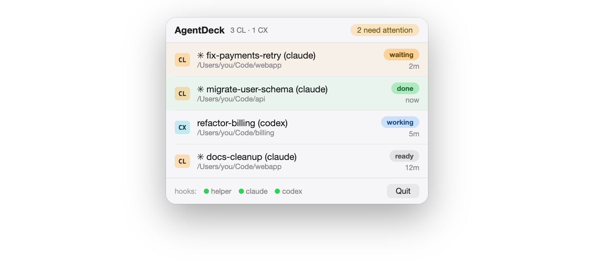

# AgentDeck

macOS menu-bar monitor for every **Claude Code** and **Codex** terminal
session you have running. See at a glance which agents are working, which
finished, and which are **blocked waiting on you** — then click a row to jump
to that exact iTerm2 tab/pane.

- Live states per session: `ready · working · waiting · done · error`
- The menu-bar badge counts only what's **blocking you** (waiting/error), and
  the glyph shows the most urgent state; finished sessions are a muted count
- Optional notification when a session has been blocked too long
- Row titles use each provider's own session name; click = jump to the
  session (its iTerm pane, or the app hosting it — a Codex session inside
  ChatGPT.app brings ChatGPT forward) and mark it handled once you've
  reached it. A blocked session in an app can't be confirmed reached, so
  dismiss it with right-click → Dismiss. ↑/↓ + Return, ⌘1–9, filter field,
  right-click actions
- A marker on sessions running **unsupervised** (approvals off)
- Event-driven via the CLIs' lifecycle hooks — no polling, no output scraping



**Scope (v1):** macOS 14+, iTerm2, Claude Code + Codex.

## What it writes on your machine (read this first)

AgentDeck's installer edits two files you own:

- `~/.claude/settings.json` — adds hook entries for 7 lifecycle events
- `~/.codex/hooks.json` — adds hook entries for 5 lifecycle events

Every edit preserves your existing settings and hooks, is idempotent, and
creates a timestamped `.bak` backup next to the file (last 5 kept). Known
trade-off: files are rewritten via JSON serialization, which normalizes
formatting/key order and can change float representation (`1.1` →
`1.1000000000000001`); the backups retain your original bytes. If the
config is a symlink (into a dotfiles repo, say), the file it points to is
edited and the link is left in place.

The hooks invoke a small helper binary
(`~/Library/Application Support/AgentDeck/bin/agentdeck-hook`) on session
events. It writes **metadata-only** snapshots — provider, session id, working
directory, state, timestamp, terminal pane id, agent pid — to
`~/Library/Application Support/AgentDeck/sessions/`. The app keeps the
restorable list of sessions under `…/AgentDeck/workspaces/` (see
[Bringing sessions back](#bringing-sessions-back-after-a-restart)).

**Privacy:** nothing leaves your machine, and no prompt, response or
credential is ever stored. The helper writes metadata only — there is a test
in the suite asserting prompt text is never persisted.

The app itself reads two things it does not store: the tail of each Claude
session transcript (`~/.claude/projects/…/<session>.jsonl`), from which it
takes only two fields off the last assistant message — `model` and
`sessionKind` — and Codex's `state_5.sqlite`, from which it selects only
metadata columns, read-only. `threads.title` is deliberately **not**
selected: Codex fills it with the user's first message unless the thread
was renamed, so the column is treated as conversation content and never
enters the process. A Codex row is named only by an explicit `/rename`.

Conversation content is parsed past but never retained, logged, or
displayed. (Through 0.4.1 that was not strictly true: an unrenamed Codex
thread's title — i.e. a prompt — could appear as a row title and in a
notification if it was under 60 characters.)

Precisely where that boundary sits: "parsed past" means transcript bytes
are read into memory to find those two fields, and discarded. Finding a
session's executable reads the process's argument block
(`KERN_PROCARGS2`), which includes its command-line arguments; only the
executable path is kept. Row titles show a session's name, and Claude
generates names from the conversation when you haven't set one, so a
title can echo what a session is about — workspace files store a name
only if you set it yourself.

### Uninstall

1. Quit AgentDeck and remove it from System Settings → General → Login
   Items if you added it there.
2. Edit `~/.claude/settings.json` and `~/.codex/hooks.json` and delete the
   hook entries whose `command` mentions `agentdeck-hook`.
3. `rm -rf ~/Library/Application\ Support/AgentDeck/` and delete the app.
4. Optional: `defaults delete com.tonyhoang.agentdeck` (acknowledgments,
   `waitAlertMinutes`); remove the `*.agentdeck-*.bak` files beside the two
   configs; `brew uninstall agentdeck && brew untap AutoXPilot/tap`.

**Don't uninstall by restoring a `.bak`.** Those are whole-file snapshots
taken before each edit, so the newest one can *contain* AgentDeck hooks
from a previous install — restoring it reinstalls them, pointed at a
helper you're about to delete. It would also discard anything you changed
in that file since the backup was taken. Backups are for recovering a
config AgentDeck damaged, not for uninstalling it.

## Install (Homebrew)

```sh
brew tap AutoXPilot/tap
brew trust AutoXPilot/tap          # newer Homebrew requires trusting third-party taps
brew install --HEAD agentdeck
agentdeck-setup                      # creates ~/Applications/AgentDeck.app
open ~/Applications/AgentDeck.app
```

Then click **Install hooks** in the popover footer, and add the app to
System Settings → General → Login Items.

Or from source:

```sh
git clone https://github.com/AutoXPilot/AgentDeck && cd AgentDeck
./install-app.sh
```

### Permission prompts you'll see (once each)

- **Automation → iTerm2** on your first row click (that's how pane focusing
  works: AppleScript session select; the `iterm2:///reveal` URL scheme is
  only a fallback because it can silently stop working).
- **Codex hook trust** on its next launch after installing hooks.
- Codex sessions started **before** the hooks were installed won't report
  until restarted. Claude sessions appear either way — see discovery
  below.

## How it works

```
claude / codex lifecycle hooks
      └─ "…/agentdeck-hook" claude|codex     (JSON on stdin, exit 0 always)
            └─ ~/Library/Application Support/AgentDeck/sessions/<provider>-<id>.json
                  └─ AgentDeck.app: directory watcher + 15s liveness sweep
```

State mapping — Claude: SessionStart→ready, UserPromptSubmit→working,
PermissionRequest/Notification(permission·elicitation_dialog·
agent_needs_input)→waiting, Stop→done, StopFailure→error, SessionEnd→remove.
`idle_prompt` and `agent_completed` are deliberately ignored: an idle agent
isn't blocked on you (Claude's own registry calls it `idle`), and a
background task finishing must not flip the main session — Stop owns "done".

Codex registers SessionStart/UserPromptSubmit/PermissionRequest/Stop/
SessionEnd (same `hooks.json` schema as Claude's settings). All verified
firing live against codex-cli 0.147.0. No StopFailure → no error state for
Codex; the liveness sweep backstops removal for crashes.

Sessions are removed when their agent exits (SessionEnd, or the sweep for
crashed/closed terminals) — except on `/clear` and resume, where the process
keeps running. Sessions that need you (waiting, error, or done and not yet
acknowledged) sort first; everything else follows, newest first. Row order
freezes while the popover is open so live events don't reshuffle rows under
your cursor; each open re-sorts.

**Hooks alone aren't enough to know a session exists.** They only report
sessions that were running when they fired, so a session started before
the hooks were installed — or one whose snapshot aged out while it sat
idle — was simply absent. On the development machine that meant 15 rows
for 36 live sessions, two of them blocked on the user, one for 72 days.
AgentDeck now also reads Claude's own registry
(`~/.claude/sessions/<pid>.json`) and shows any live session that has no
snapshot. Those files outlive their process, so each is checked against
a live pid whose start time is consistent with the session's — enough to
reject an obviously recycled pid, not a proof of identity, so a stale row
is possible. Where a snapshot exists it supplies the row, since it
carries the pane id and the hook-derived state. `done` and `error` are
never inferred this way; they are facts only a hook can supply. Codex has
no equivalent registry, so it remains hook-only.

A discovered row has no recorded pane id, since no hook ran to capture
one. AgentDeck finds the pane by the agent process's controlling
terminal, matched against the tty of each iTerm session, never by
folder or title, since several sessions often share both. The match
refreshes when the popover opens. A click marks a session handled
only after AgentDeck has actually focused its pane. Otherwise a blocked
session would lose its badge while you ended up somewhere else, which
could happen if the pane had closed since the last refresh.

**Hooks alone aren't enough to know if a session is blocked.** Nothing fires
when a permission prompt is *answered*, so a `waiting` row could outlive the
block by hours, and a block that arrived without a hook never showed at all.
AgentDeck therefore reconciles each Claude row against Claude's own session
registry (`~/.claude/sessions/<pid>.json`, matched on pid *and* session id),
preferring whichever observation is newer. That registry also supplies the
session name and the reason a session is blocked. Codex rows read
`~/.codex/session_index.jsonl` and `~/.codex/state_5.sqlite` (read-only) for
names, model, effort, token totals, branch and approval mode.

Two kinds of session have no such second source, so their `waiting` clears
only on the next hook event and can read stale in between: Codex sessions
(no registry exists), and Claude **background** sessions — `claude
--bg-pty-host`, started from a slash command and reparented to launchd,
which write no `~/.claude/sessions/<pid>.json` entry at all. Background
sessions also have no terminal pane and no window, so they can't be
focused; their rows say where the prompt is actually answered (the agents
panel of the session that spawned them) instead of just reporting the dead
end. AgentDeck spots them by the `sessionKind` Claude records in the
session transcript.

Row titles come from the best available source, refreshed on popover open.
Claude rows prefer the session's own name from its registry (available even
outside iTerm), then the live iTerm tab title, then the folder. Codex rows
use the `/rename` name from `~/.codex/session_index.jsonl`, then the tab
title, then the folder — never the `state_5.sqlite` thread title, which is
the user's first message on any thread that wasn't renamed.

Each row shows the model it's running next to the path ("Opus 5.5",
"Astra 6"); the raw identifier, effort and token totals are in the tooltip.

No single source gets the model right. Claude's hook payload sometimes
names a model the session isn't running (seen: `claude-fable-5-1` reported
for a session whose transcript was 160/160 `claude-opus-5-5`), while the
session transcript never records the `[1m]` long-context qualifier that
the payload does. AgentDeck takes the model from the transcript's last
assistant turn and the qualifier from the payload when the two agree on
which model it is. Transcript-derived facts refresh while the popover is
open, not only when it opens, so a mid-session `/model` switch shows up.

Codex's `state_5.sqlite` is read when the popover opens, and a hook event
that supplied a model *after* that read wins over the cache. The
comparison uses when the model was last actually reported, not when the
snapshot was last written — events that omit the model still touch the
snapshot while carrying the old model forward, so the write time says
nothing about how current the model is.

## Bringing sessions back after a restart

Rebooting, or quitting iTerm to update it, closes every agent session.
AgentDeck remembers them and can resume each conversation in its folder.

- **After a restart**, the popover offers the sessions that were open
  before it. **Restore** reopens them as tabs in a new iTerm window,
  starting iTerm first if it isn't running. Dismissed, it stays in the
  footer menu (⋯ → Restore), along with each earlier boot AgentDeck
  still remembers.
- **Closed <time>** in the same menu covers quitting iTerm without a
  reboot: each group of sessions that closed together, most recent
  first.
- **Save open sessions as workspace…** keeps a named set you can restore
  any time. Named workspaces are never changed or pruned automatically.

Each session is restored by typing `cd <folder> && claude --resume <id>`
(or `codex resume <id>`) into a new tab. The tab uses your default iTerm
profile, so that profile has to start a POSIX-style shell (zsh, bash);
one that runs ssh or tmux instead won't work, and neither will a shell
startup that stops to ask something, which swallows the typed line.
Sessions start five at a time, each group given up to ten seconds to come
up before the next. Claude's permission mode is carried over when a hook
recorded it; a session AgentDeck only found through Claude's own session
list has no recorded mode and comes back in your default.

Sessions already open are skipped, as are ones whose folder or
conversation is gone, and the footer names them and says why. (For Codex,
if its database can't be read the conversation can't be checked, and the
launch goes ahead.) A session whose folder moved gets a **Locate…**
button: pick the new folder and it resumes there, and a named workspace
it came from remembers the new location. The footer counts sessions as
they start, then, 30 seconds later, says how many are running by Claude's
own session list, naming any that aren't yet — a tab stopped at a prompt
(a folder trust question, say). When the agent exits, the tab drops back
to a shell instead of closing. Background sessions and Codex sessions
hosted in an app aren't captured, since there's no terminal to return
them to.

A session restore has launched — or may have, if iTerm didn't confirm —
isn't launched again until it shows up as running. That is recorded on
disk, so it holds across relaunching AgentDeck and between two running
copies. Nothing expires it on a timer, since a tab waiting at a prompt
will still start the conversation once answered; the footer lists any
that haven't appeared, with a **Clear** for when you've checked iTerm and
they aren't there.

Sessions known to be running outside iTerm (Terminal.app, an editor's
terminal) aren't captured, since restoring them would move them into
iTerm. A Claude session inside tmux counts as outside: its terminal is
tmux's, not an iTerm pane, so AgentDeck can't focus it either. Shell plugins that rewrite what's typed — auto-closing quotes, for
instance — can mangle the restore command; restore types it as if at the
keyboard.

How it decides what to offer: AgentDeck keeps one record per boot under
`~/Library/Application Support/AgentDeck/workspaces/` and only ever adds
to it. A session that stops running keeps its last-seen time rather than
being removed. Shutting down closes sessions one at a time, so a record
that tracked the live list would be empty by the time you needed it.
When sessions stop running, AgentDeck records them as a group: closures
within five minutes of each other join the same group, however long the
whole quit takes. A session has to be missing from two refreshes in a row
to count as closed, so one that drops out of a single refresh isn't
mistaken for one that stopped. Sessions that closed while AgentDeck
wasn't running — quit, or being updated — are recorded as a group when it
next starts. Groups are recorded when they happen, so a session you
close later starts its own group rather than redefining the earlier one,
and restoring part of a group leaves the rest of it on offer. For an
earlier boot it also offers whatever was still running when that boot's
record ends, which covers a shutdown AgentDeck didn't see, such as
quitting before iTerm at logout. The banner after a restart shows the
largest of the previous boot's groups, and the menu shows up to three
groups per boot, newest first, always including the largest. The current boot's record plus the
five most recent earlier ones are kept.

These files hold a folder, a session id, Claude's permission mode, and a
session name only if you set one yourself. The command a session was
started with is never stored: it can contain a prompt or a credential.
Restore builds the command from the id, which must be a UUID, and refuses
a folder path that is relative or contains a control character (typed
into a terminal, a control character acts as a keystroke).

## Hardening notes

- On launch the app compares the bundled helper's SHA-256 against the stable
  copy hooks invoke and atomically updates it on drift — upgrading can never
  leave hooks running an old helper. A stale helper shows as unhealthy in
  the footer (`hooks: ● helper ● claude ● codex` = setup health, not
  session activity).
- A snapshot's pid is trusted only if a live process started at or before the
  snapshot's last update *and* looks like the agent (its executable path or
  name says claude or codex). A recycled pid fails one or the other. A
  session that passes both is kept however long it sits quiet — a Codex
  session waiting for input over a weekend used to lose its row at seven
  days; pid-less snapshots still go after 24 hours.
- `session_id` is sanitized before becoming a filename; hook payloads can
  never write outside the sessions directory. Stale temp/corrupt files are
  swept. The sessions-dir watcher re-arms if the directory is recreated.
- The helper can't hold up an agent turn for long: bounded stdin read, an
  8s watchdog, silent exit on any error. If it can't take the per-session
  lock it drops that one event rather than writing unlocked.
- Hook commands single-quote the helper's path, so no character in it is
  interpreted by the shell.

## Can't find the menu-bar icon?

On notched MacBooks the menu bar has limited room, and macOS silently hides
whatever doesn't fit — third-party items first. AgentDeck saves its position,
so **⌘-drag it once** to a spot you like (leftward, nearer the notch) and it
stays there across launches and upgrades.

If the bar is genuinely full, free up room by hiding items you don't need
(System Settings → Control Center), or use a menu-bar manager such as
[Ice](https://github.com/jordanbaird/Ice) or Bartender. The icon is narrow
when nothing is blocked (just the glyph) and widens with a count when
sessions need you.

## Notifications

A session that stays blocked longer than `waitAlertMinutes` (default 5) posts
a local notification. To avoid pestering, a given session notifies at most
once per hour even across separate blocks. macOS will ask for permission the
first time the app runs. To change or disable:

```sh
defaults write com.tonyhoang.agentdeck waitAlertMinutes -int 10   # or 0 to disable
```

## Tested against

| Component | Version |
|---|---|
| macOS | 14+ (developed on 26.x) |
| Claude Code | 2.1.306 |
| Codex CLI | 0.159.3 |
| iTerm2 | 3.7.0 |

Other terminals: rows still appear and states are correct, but there's no
pane to focus — those rows say so instead of failing silently.

## Development

```sh
swift build && ./test.sh    # 285 tests; works with CLT-only or full Xcode
```

See [CONTRIBUTING.md](CONTRIBUTING.md) for the ground rules (each encodes a
production bug this project already hit — quoting, p_comm, AppleScript
dictionary shadowing, and friends).

## License

MIT — see [LICENSE](LICENSE).
